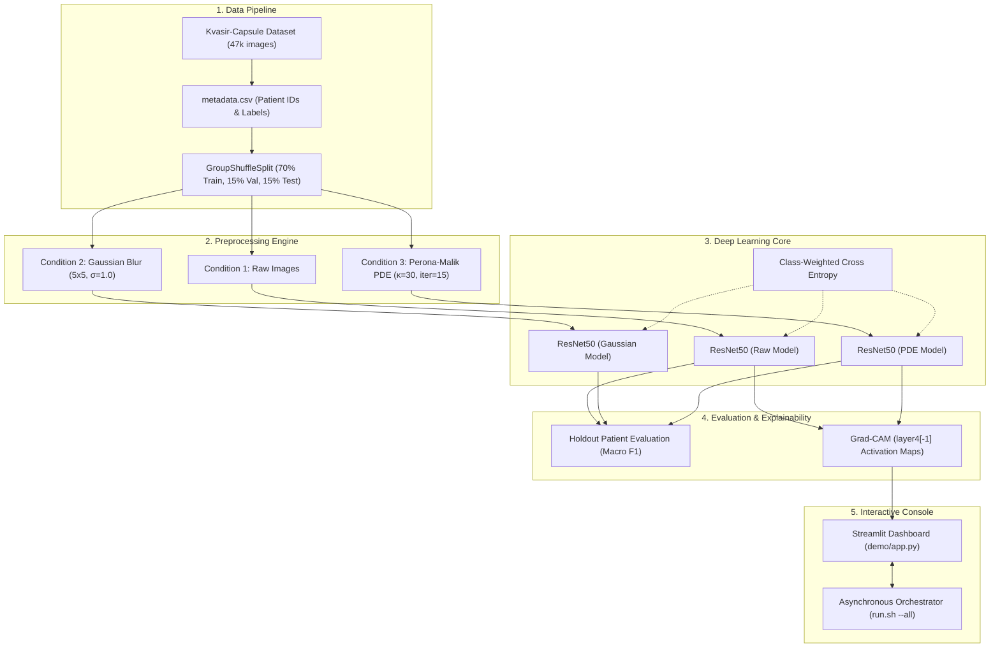

# 03: System Architecture

## 1. High-Level Modular Architecture
EndoClean is structured into five decoupled subsystems:
1. **Data Pipeline:** Metadata extraction, patient-wise stratified partitioning, and augmentation.
2. **Preprocessing Engine:** Vectorized Perona-Malik PDE solver and Gaussian blur baseline.
3. **Deep Learning Core:** Pre-trained ResNet50 feature extractor with fine-tuned residual blocks and class-weighted loss.
4. **Explainability & Evaluation:** Grad-CAM saliency mapping and multi-metric aggregation across experimental seeds.
5. **Interactive Console & Orchestrator:** Streamlit web interface with asynchronous background process management.



---

## 2. Hardware Compute Routing
All scripts incorporate dynamic hardware abstraction:
```python
if torch.cuda.is_available():
    device = torch.device('cuda')       # NVIDIA GPUs
elif torch.backends.mps.is_available():
    device = torch.device('mps')        # Apple Silicon Metal Performance Shaders
else:
    device = torch.device('cpu')        # Fallback CPU
```
