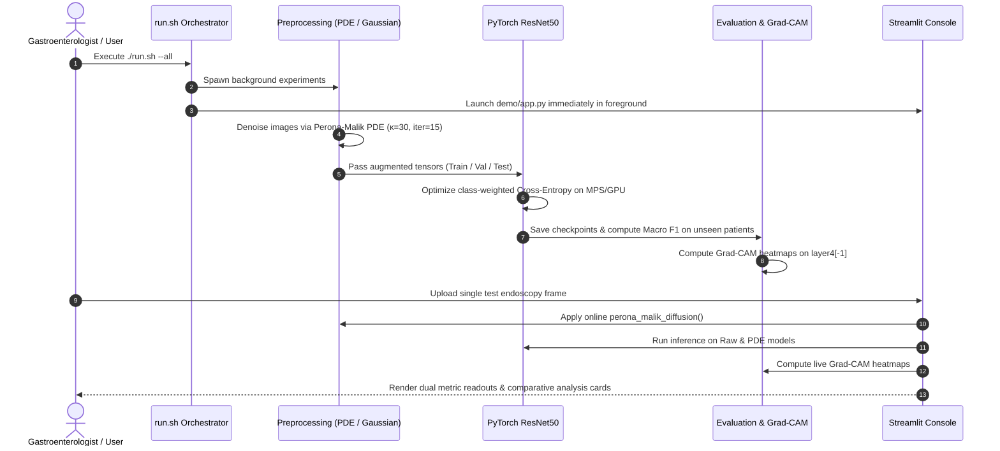

# 04: Project Workflow

This document traces the complete execution lifecycle of EndoClean from raw video ingestion to clinical visualization.

### Sequential Operational Stages
1. **Metadata Structuring:** `prepare_metadata.py` ingests official Kvasir splits, extracts `video_id`, and formats `data/metadata.csv`.
2. **Offline Preprocessing:** `process_folder()` runs Perona-Malik diffusion across 47,238 frames, populating `data/pde_denoised/`.
3. **Model Training:** `src/train.py` fine-tunes ResNet50 across data regimes and random seeds ($42, 43, 44$).
4. **Performance Verification:** `src/evaluate.py` verifies generalization on held-out patient videos.
5. **Explainability Extraction:** `src/gradcam.py` synthesizes spatial heatmaps.
6. **Clinical Inference:** `demo/app.py` serves the final interactive diagnostic application.
