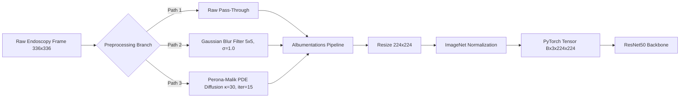

# 09: Image Processing Pipeline

## 1. End-to-End Image Processing Flow

## 2. Quantitative Image Quality Metrics
Evaluating denoising on synthetic noise benchmarks (`results/tuning_results.csv`):
- **Unprocessed Noisy Input:** PSNR: 18.21 dB, SSIM: 0.3080
- **Gaussian Blurred ($5\times 5, \sigma=1.0$):** PSNR: 25.36 dB, SSIM: 0.6042
- **Perona-Malik PDE ($\kappa=30, \text{iter}=15$):** PSNR: 20.64 dB, SSIM: 0.5211

*Key Insight:* While Gaussian blur achieves higher raw PSNR by aggressively smoothing global pixel variances, it blurs lesion edges. Perona-Malik preserves sharp edge discontinuities that are vital for CNN classification.
